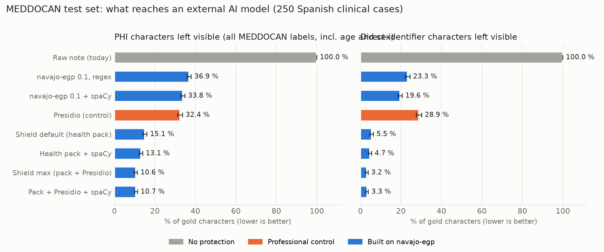

# EGP Clinical Shield

**Pseudonymise a clinical note on the clinician's own computer, ask any AI assistant, and get the answer back with the real names restored.**

Built on [navajo-egp](poc/navajo_egp) (Project NAVAJO, MIT licence) with a new health pack for Spanish clinical documents, and a pre-registered evaluation on 1,000 public synthetic clinical cases. Prepared for the MIT Solve 2027 Global Health Challenge.

> Status: **prototype**. No clinic uses it. All numbers come from synthetic cases, not real patient notes. It **reduces** what an AI provider sees; it does not remove all identifiers, and pseudonymised data are still personal data under GDPR.

## The problem in one paragraph

Frontline clinicians already use AI assistants for letters, summaries and differential diagnoses, but those assistants run on third-party servers. Pasting a note sends the patient's name, record numbers, address and dates with it, which data-protection law treats as special-category data. Health services respond by banning AI for patient work, or staff use it anyway. Sources in [docs/SOURCES.md](docs/SOURCES.md).

## What it does

```
clinical note ──► mask on the PC (names, IDs, addresses, dates, institutions → ENTITY_A, ID_001 …)
                   │  age, sex, symptoms, labs and drugs stay: the model needs them
                   │  a final check refuses to send if a hard identifier (e-mail, ID, card, IBAN) is still visible
                   ▼
              any AI assistant (OpenAI, Anthropic, a local model …) sees the masked text
                   ▼
answer ◄── restore the real values from an in-memory mapping, then destroy the mapping
```

```python
import sys; sys.path.insert(0, "poc")
from deid.shield import ClinicalShield
from openai import OpenAI

client = ClinicalShield().wrap(OpenAI())              # default mode: health pack, no ML model
# client = ClinicalShield(mode="max").wrap(OpenAI())  # maximum protection: health pack + Presidio
reply = client.chat.completions.create(model="…", messages=[{"role": "user", "content": note}])
```

- Detection in the default mode takes under 3 ms per note on a 2019 desktop CPU (Ryzen 7 3700X); no GPU and no model. Not yet measured on a laptop.
- Masking is lossless: with an echo model every test note comes back exactly. With a real model, restoration depends on the model keeping the placeholders, which we have not measured.
- The OpenAI and Anthropic wrappers mask the text of every message and text block of the conversation (earlier replies carry restored names) with one session per request, so the same person keeps the same placeholder. Content they cannot mask (images, tool calls, extra message fields, request arguments such as `tools` or `extra_body`) is refused before anything is sent, and other client APIs (`responses`, `files` …) are not exposed. The mapping is destroyed even if the provider call fails. The LangChain wrapper accepts plain-text prompts only.

## Results

Pre-registered evaluation ([experiments/PREREGISTRO.md](experiments/PREREGISTRO.md)) on [MEDDOCAN](https://doi.org/10.5281/zenodo.4279323): 1,000 synthetic Spanish clinical cases with gold annotations (500 train, 250 dev, 250 test), scored with the official MEDDOCAN scorer. The evaluated health pack (cycle c2) was built on train only; **test was run once, for every system at the same time**. Later analyses on test changed no system. Lower is better everywhere.



| Test set, 250 notes | Primary: sensitive spans not matched exactly | Sensitive characters left visible* | Direct-identifier characters left visible | Non-sensitive text masked by mistake | Notes with ≥1 direct identifier fully visible | ms per note |
|---|---|---|---|---|---|---|
| Raw note (what happens today) | 100 % | 100 % | 100 % | 0 % | 100 % | — |
| Microsoft Presidio (control, default Spanish setup) | 59.3 % | 32.4 % | 28.9 % | 5.2 % | 100 % | 50 |
| navajo-egp 0.1 + spaCy (before this work) | 68.6 % | 33.8 % | 19.6 % | 2.2 % | 93.6 % | 32 |
| **Shield, default mode** (health pack, no ML model) | **31.3 %** | **15.1 %** | **5.5 %** | **1.2 %** | **24.8 %** | **2.7** |
| **Shield, maximum protection** (health pack + Presidio) | 39.1 % | **10.6 %** | **3.2 %** | 5.6 % | **13.6 %** | 52 |

\* All MEDDOCAN labels, including age and sex, which the shield keeps on purpose; whitespace inside spans counts. 95 % bootstrap intervals and paired tests: [docs/RESULTS.md](docs/RESULTS.md).

- **H1, rejected.** navajo-egp 0.1 alone did not beat Presidio: +1.39 points of exposure, 95 % CI [+0.06, +2.65].
- **H2, rejected narrowly.** The health pack with spaCy cut exposure by 22.3 points on dev but raised over-masking by 2.07 points; the pre-set limit was 2. The default mode (no spaCy) lowers over-masking instead.
- **H3, confirmed.** Health pack + Presidio exposes less than the pack alone (−2.43 points) and than Presidio (−21.79).
- The navajo-egp core detectors account for 6.26 points of the default mode's reduction on full notes and 13.28 on narrative text, beyond the health pack's own patterns ([docs/POSTHOC.md](docs/POSTHOC.md)).
- **Residual risk is real:** in 24.8 % of notes (default) and 13.6 % (maximum) at least one direct identifier stays fully visible; in 69.2 % and 54.4 % some character of one does ([docs/RESIDUAL_RISK.md](docs/RESIDUAL_RISK.md)).
- **Stress test without the form-like header** (62 % of the annotated spans sit there, [docs/stress](docs/stress)): Presidio 28.6 %, default 24.6 % (−3.98, CI [−6.50, −1.42]), maximum 17.3 %. Much of the margin on full notes comes from the header.
- Systems trained on MEDDOCAN reached span F1 0.9749 in the 2019 shared task; the rule-based default mode reaches 0.743 without any training data.
- Audit corrections (metric definitions, residual-risk count, wrapper integration, a byte-order-mark and an e-mail bug) are logged as E009–E013 in [experiments/LOG.md](experiments/LOG.md). The two bugs are fixed in cycle c3, checked on train and dev only; the test numbers above are from the frozen cycle c2.

## Reproduce

Linux with Python 3.13 (tested on Debian 13), about 25 minutes on 4 CPU cores:

```bash
bash poc/run_server.sh   # pinned and checked environment, MEDDOCAN (md5 checked), official scorer (commit checked), 8 systems, report, then poc/run_posthoc.sh
python -m pytest tests   # 50 tests; the core needs no extra packages
```

`poc/run_posthoc.sh` rebuilds the stress test, the core ablation and the residual-risk tables (outputs in `poc/results_posthoc/`); re-running it reproduced every published number exactly. `poc/recount.py` recomputes metrics from saved predictions (E011). Exact environment of E007: `poc/requirements.lock.txt`.

## What is masked and what is kept

| Masked (direct identifiers and places) | Kept on purpose (clinically needed) |
|---|---|
| Patient, relative and clinician names; record, insurance, episode and licence numbers; phone, fax, e-mail, URLs; streets, postcodes, towns, provinces, countries; hospitals and institutions; dates | Age, sex, kinship words ("su madre"), symptoms, findings, lab values, drugs and doses |

Keeping age and sex follows NAVAJO's EGP design ("67 años → keep, needed for dosing"). MEDDOCAN counts them as sensitive, so the all-label numbers penalise this choice; the direct-identifier columns do not include them.

## Limitations

- Synthetic Spanish cases from one corpus with a uniform header template; real notes are messier, and the margin over Presidio shrinks on narrative text.
- Rule-based detection: about one note in four keeps at least one fully visible direct identifier in the default mode. Not a replacement for validated de-identification pipelines.
- Placeholders protect identity, not every quasi-identifier: a rare disease plus a small town can still point to a person.
- How well real AI models keep and use placeholders is not measured yet.
- Not a medical device and not legal advice. A clinic that deploys it still needs its own data-protection impact assessment and legal basis.

## Licences

Code: MIT ([LICENSE](LICENSE)). MEDDOCAN data: CC BY 4.0, downloaded at run time, not redistributed (the residual-risk audit quotes 30 short synthetic fragments with attribution). Official MEDDOCAN scorer: MIT. Presidio: MIT. spaCy `es_core_news_lg`: GPL-3.0, downloaded at run time, not redistributed.

## Citation

```bibtex
@software{angulo2026egpclinical,
  title  = {EGP Clinical Shield: reversible pseudonymisation of clinical notes before AI assistants},
  author = {Angulo de Lafuente, Francisco},
  year   = {2026},
  url    = {https://github.com/Agnuxo1/egp-clinical-shield}
}
```
