<div align="center">

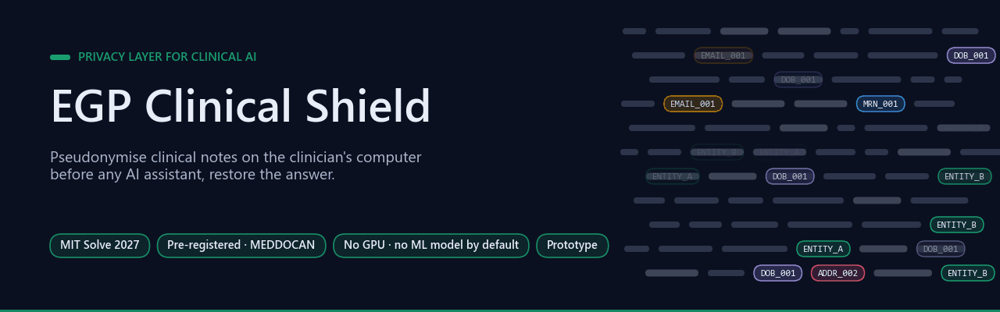

# EGP Clinical Shield

[](https://github.com/Agnuxo1/egp-clinical-shield/actions/workflows/tests.yml) [](LICENSE)   [](experiments/PREREGISTRO.md) [](https://doi.org/10.5281/zenodo.4279323) [](https://solve.mit.edu/)

[**Results**](#results) · [**Reproduce**](#reproduce) · [**Limitations**](#limitations) · [**Full results**](docs/RESULTS.md) · [**Pre-registration**](experiments/PREREGISTRO.md) · [**Experiment log**](experiments/LOG.md) · [**Cite**](#citation)

</div>

**Pseudonymise a clinical note on the clinician's own computer, ask any AI assistant, and get the answer back with the real names restored.**

Built on [navajo-egp](poc/navajo_egp) (Project NAVAJO, MIT licence) with a new health pack for Spanish clinical documents, and a pre-registered evaluation on 1,000 public synthetic clinical cases. Prepared for the MIT Solve 2027 Global Health Challenge.

> Status: **prototype**. No clinic uses it. All numbers come from synthetic cases, not real patient notes. It **reduces** what an AI provider sees; it does not remove all identifiers, and pseudonymised data are still personal data under GDPR.

**Contents** — [The problem in one paragraph](#the-problem-in-one-paragraph) · [Background](#background) · [What it does](#what-it-does) · [Results](#results) · [Reproduce](#reproduce) · [What is masked and what is kept](#what-is-masked-and-what-is-kept) · [Limitations](#limitations) · [Real-world applications](#real-world-applications) · [Possible improvements](#possible-improvements) · [Future work](#future-work) · [Licences](#licences) · [Citation](#citation) · [Bibliography](#bibliography)

## The problem in one paragraph

<p align="center">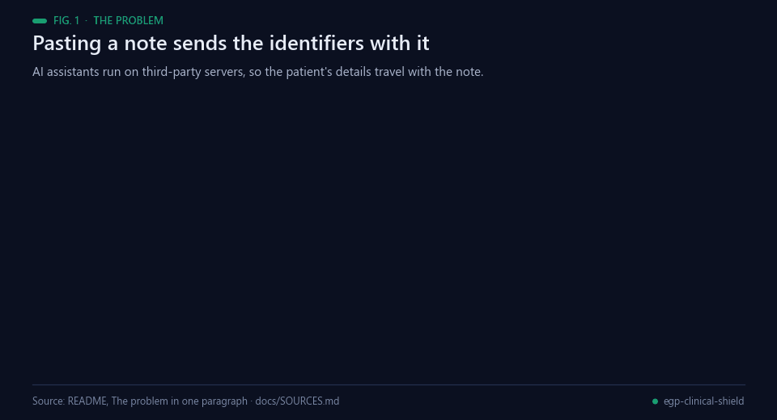<br><sub>Fig. 1 — Today, identifiers travel with the note. Sources: docs/SOURCES.md.</sub></p>

Frontline clinicians already use AI assistants for letters, summaries and differential diagnoses, but those assistants run on third-party servers. Pasting a note sends the patient's name, record numbers, address and dates with it, which data-protection law treats as special-category data. Health services respond by banning AI for patient work, or staff use it anyway. Sources in [docs/SOURCES.md](docs/SOURCES.md).

## Background

<p align="center">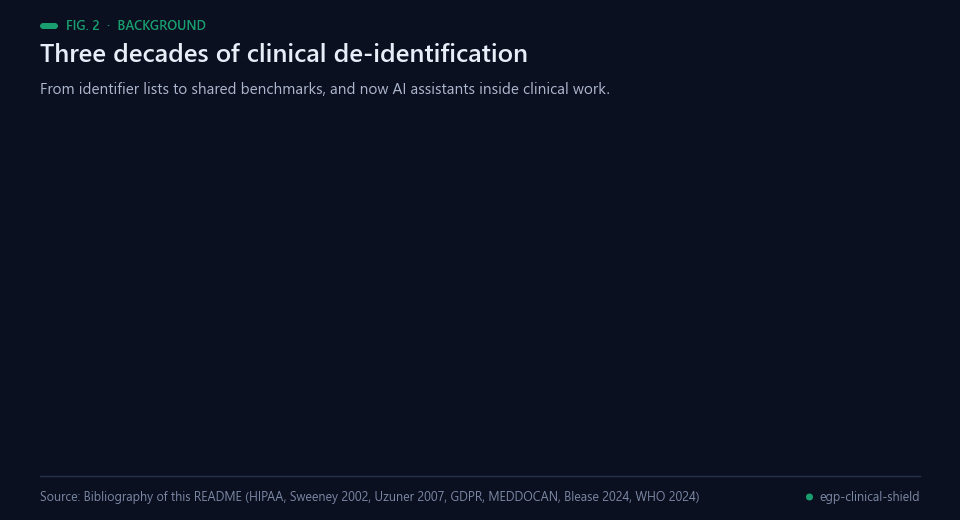<br><sub>Fig. 2 — Milestones behind this work. Sources: bibliography below.</sub></p>

Automatic de-identification of clinical text has a long, well-measured history. The US HIPAA Privacy Rule defines a
"Safe Harbor" list of identifiers to remove [[10](#ref-10)], and Sweeney's *k*-anonymity model showed why removing names is
not enough: combinations of quasi-identifiers can still single a person out [[8](#ref-8)]. Shared benchmarks then turned
the problem into measurable science — the 2006 i2b2 challenge [[4](#ref-4)] and the 2014 i2b2/UTHealth corpus [[5](#ref-5)]
for English, and in 2019 MEDDOCAN, the first shared track on anonymising Spanish medical documents, built on a
synthetic corpus of clinical case reports with an official scorer [[1](#ref-1), [2](#ref-2), [17](#ref-17)]. Reviews trace the shift from
rules and dictionaries to statistical and neural sequence labellers [[6](#ref-6), [7](#ref-7)], and the broader difficulty of
anonymising free text [[9](#ref-9)]; the top-scoring MEDDOCAN systems used deep learning [[1](#ref-1), [3](#ref-3)].

What changed recently is *where* de-identification has to run. General-purpose AI assistants entered clinical work:
in a 2024 survey, 20 % of UK GPs reported using generative AI in clinical practice, most often for documentation
after appointments [[12](#ref-12)]. WHO's 2024 guidance on large multi-modal models adds explicit data-protection
obligations and impact assessments [[13](#ref-13)], on top of the GDPR's special-category rules for health data
[[11](#ref-11)]. A shield for this setting must sit in front of the assistant, run on the computer where the note is
written, and hand the answer back with the real names — a different design problem from batch de-identification
of a research corpus.

This repository builds on the author's Project NAVAJO, whose `navajo-egp` package (Ephemeral Generalization
Protocol, vendored in [`poc/navajo_egp`](poc/navajo_egp)) provides session-scoped, reversible placeholders for LLM
calls. The new work is the Spanish health pack, the clinical wrapper and a pre-registered evaluation [[19](#ref-19)]
against Microsoft Presidio [[16](#ref-16)] with spaCy models [[15](#ref-15)] as the professional control, reported with paired
bootstrap intervals [[18](#ref-18)].

## What it does

<p align="center">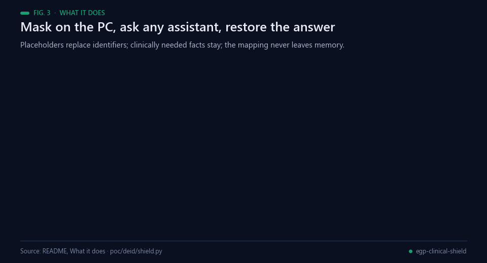<br><sub>Fig. 3 — The round trip. The mapping lives only in memory and is destroyed after the answer.</sub></p>

```
clinical note ──► mask on the PC (names, IDs, addresses, dates, institutions → ENTITY_A, ID_001 …)
                   │  age, sex, symptoms, labs and drugs stay: the model needs them
                   │  a final check refuses to send if a hard identifier (e-mail, ID, card, IBAN) is still visible
                   ▼
              any AI assistant (OpenAI, Anthropic, a local model …) sees the masked text
                   ▼
answer ◄── restore the real values from an in-memory mapping, then destroy the mapping
```

```python
import sys; sys.path.insert(0, "poc")
from deid.shield import ClinicalShield
from openai import OpenAI

client = ClinicalShield().wrap(OpenAI())              # default mode: health pack, no ML model
# client = ClinicalShield(mode="max").wrap(OpenAI())  # maximum protection: health pack + Presidio
reply = client.chat.completions.create(model="…", messages=[{"role": "user", "content": note}])
```

<p align="center">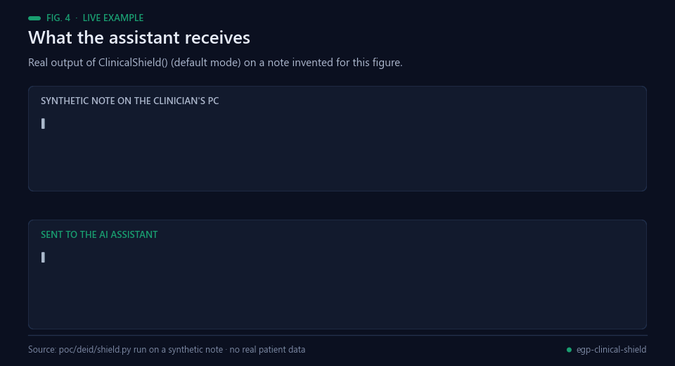<br><sub>Fig. 4 — Real output of <code>ClinicalShield()</code> (default mode) on a note invented for this figure.</sub></p>

- Detection in the default mode takes under 3 ms per note on a 2019 desktop CPU (Ryzen 7 3700X); no GPU and no model. Not yet measured on a laptop.
- Masking is lossless: with an echo model every test note comes back exactly. With a real model, restoration depends on the model keeping the placeholders, which we have not measured.
- The OpenAI and Anthropic wrappers mask the text of every message and text block of the conversation (earlier replies carry restored names) with one session per request, so the same person keeps the same placeholder. Content they cannot mask (images, tool calls, extra message fields, request arguments such as `tools` or `extra_body`) is refused before anything is sent. Only message and system text is masked; the model name (a plain identifier) and numeric settings pass as given. Other client APIs (`responses`, `files` …) are not available through the wrapper; the original client object is, so code must use the wrapper. The mapping is destroyed even if the provider call fails. The LangChain wrapper accepts plain-text prompts only.

## Results

<p align="center">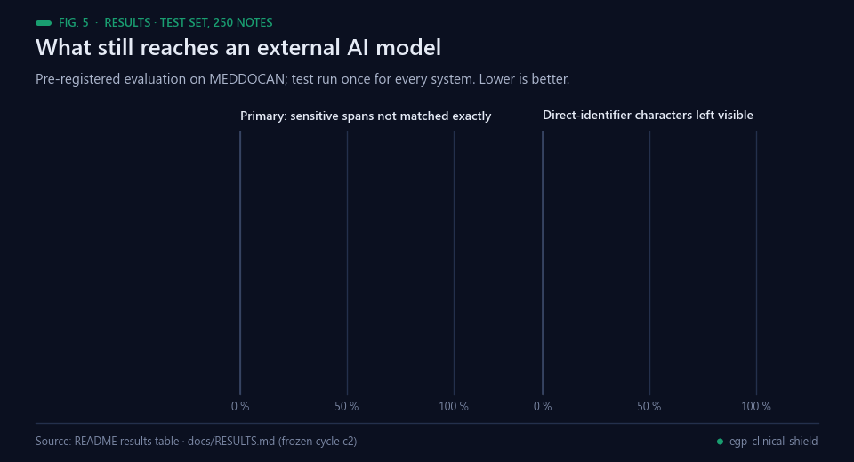<br><sub>Fig. 5 — Test set, 250 notes, lower is better. Data: the table below and docs/RESULTS.md.</sub></p>

Pre-registered evaluation ([experiments/PREREGISTRO.md](experiments/PREREGISTRO.md)) on [MEDDOCAN](https://doi.org/10.5281/zenodo.4279323): 1,000 synthetic Spanish clinical cases with gold annotations (500 train, 250 dev, 250 test), scored with the official MEDDOCAN scorer. The evaluated health pack (cycle c2) was built on train only; **test was run once, for every system at the same time**. Later analyses on test changed no system. Lower is better everywhere.


| Test set, 250 notes | Primary: sensitive spans not matched exactly | Sensitive characters left visible* | Direct-identifier characters left visible | Non-sensitive text masked by mistake | Notes with ≥1 direct identifier fully visible | ms per note |
|---|---|---|---|---|---|---|
| Raw note (what happens today) | 100 % | 100 % | 100 % | 0 % | 100 % | — |
| Microsoft Presidio (control, default Spanish setup) | 59.3 % | 32.4 % | 28.9 % | 5.2 % | 100 % | 50 |
| navajo-egp 0.1 + spaCy (before this work) | 68.6 % | 33.8 % | 19.6 % | 2.2 % | 93.6 % | 32 |
| **Shield, default mode** (health pack, no ML model) | **31.3 %** | **15.1 %** | **5.5 %** | **1.2 %** | **24.8 %** | **2.7** |
| **Shield, maximum protection** (health pack + Presidio) | 39.1 % | **10.6 %** | **3.2 %** | 5.6 % | **13.6 %** | 52 |

\* All MEDDOCAN labels, including age and sex, which the shield keeps on purpose; whitespace inside spans counts. 95 % bootstrap intervals and paired tests: [docs/RESULTS.md](docs/RESULTS.md).

<p align="center">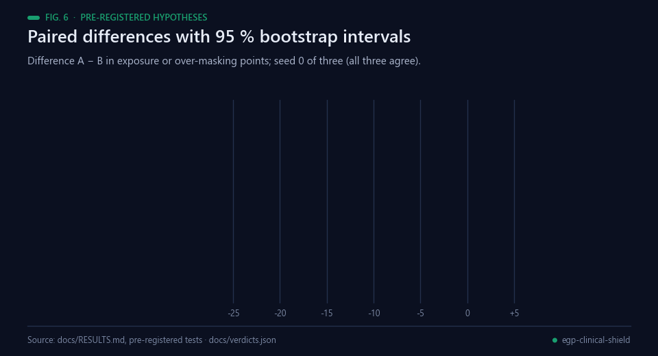<br><sub>Fig. 6 — Pre-registered comparisons (seed 0 of three). Data: docs/RESULTS.md, docs/verdicts.json.</sub></p>

- **H1, rejected.** navajo-egp 0.1 alone did not beat Presidio: +1.39 points of exposure, 95 % CI [+0.06, +2.65].
- **H2, rejected narrowly.** The health pack with spaCy cut exposure by 22.3 points on dev but raised over-masking by 2.07 points; the pre-set limit was 2. The default mode (no spaCy) lowers over-masking instead.
- **H3, confirmed.** Health pack + Presidio exposes less than the pack alone (−2.43 points) and than Presidio (−21.79).
- The navajo-egp core detectors account for 6.26 points of the default mode's reduction on full notes and 13.28 on narrative text, beyond the health pack's own patterns ([docs/POSTHOC.md](docs/POSTHOC.md)).
- **Residual risk is real:** in 24.8 % of notes (default) and 13.6 % (maximum) at least one direct identifier stays fully visible; in 69.2 % and 54.4 % some character of one does ([docs/RESIDUAL_RISK.md](docs/RESIDUAL_RISK.md)).
- **Stress test without the form-like header** (62 % of the annotated spans sit there, [docs/stress](docs/stress)): Presidio 28.6 %, default 24.6 % (−3.98, CI [−6.50, −1.42]), maximum 17.3 %. Much of the margin on full notes comes from the header.
- Systems trained on MEDDOCAN reached span F1 0.9749 in the 2019 shared task; the rule-based default mode reaches 0.743 without any training data.
- Audit corrections (metric definitions, residual-risk count, wrapper integration, a byte-order-mark and an e-mail bug) are logged as E009–E013 in [experiments/LOG.md](experiments/LOG.md). The two bugs are fixed in cycle c3, checked on train and dev only; the test numbers above are from the frozen cycle c2.

## Reproduce

<p align="center">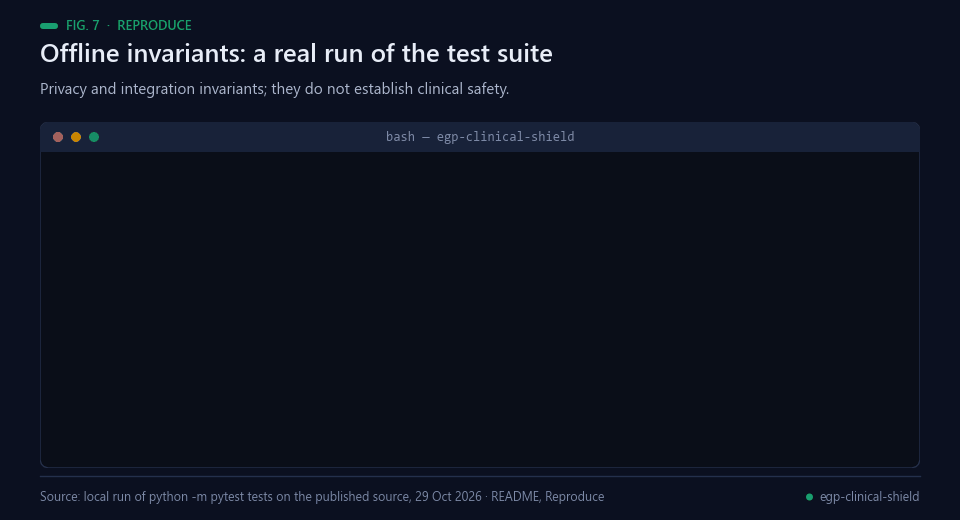<br><sub>Fig. 7 — A real local run of the offline test suite on the published source.</sub></p>

**Independent software check, 29 October 2026:** all 51 offline tests passed
on the published source. GitHub Actions now repeats these checks on pushes
and pull requests. They test privacy/integration invariants; they do not
establish clinical safety or replace the frozen MEDDOCAN benchmark above.

Linux with Python 3.13 (tested on Debian 13), about 25 minutes on 4 CPU cores:

```bash
bash poc/run_server.sh   # pinned and checked environment, MEDDOCAN (md5 checked), official scorer (commit checked), 8 systems, report, then poc/run_posthoc.sh
python -m pytest tests   # 51 tests; the core needs no extra packages
```

`poc/run_posthoc.sh` rebuilds the stress test, the core ablation and the residual-risk tables (outputs in `poc/results_posthoc/`); re-running it reproduced every published metric exactly (timings vary by machine). `poc/recount.py` recomputes metrics from saved predictions (E011). Exact environment of E007: `poc/requirements.lock.txt`.

## What is masked and what is kept

<p align="center">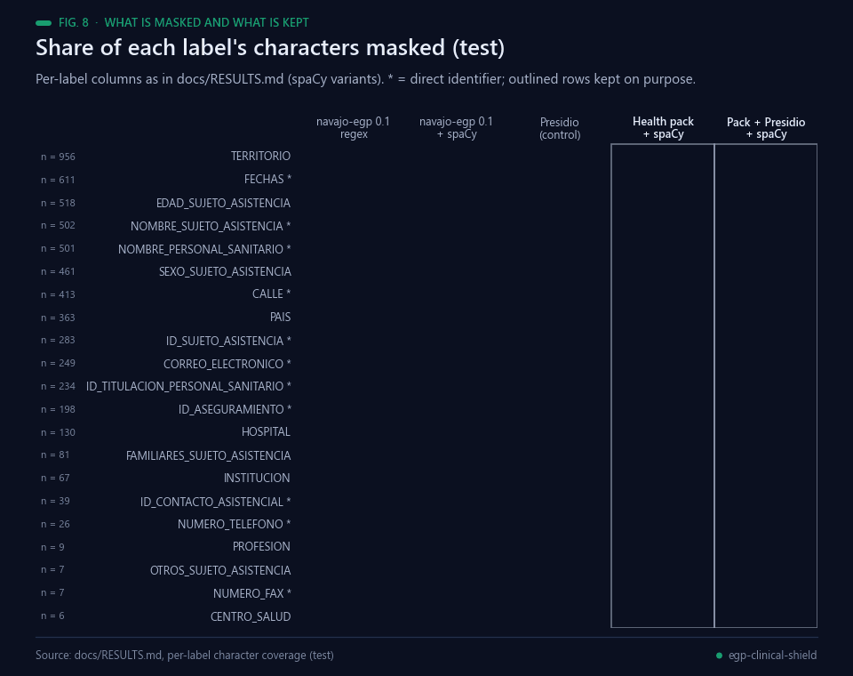<br><sub>Fig. 8 — Per-label character coverage on the test set. Data: docs/RESULTS.md.</sub></p>

| Masked (direct identifiers and places) | Kept on purpose (clinically needed) |
|---|---|
| Patient, relative and clinician names; record, insurance, episode and licence numbers; phone, fax, e-mail, URLs; streets, postcodes, towns, provinces, countries; hospitals and institutions; dates | Age, sex, kinship words ("su madre"), symptoms, findings, lab values, drugs and doses |

Keeping age and sex follows NAVAJO's EGP design ("67 años → keep, needed for dosing"). MEDDOCAN counts them as sensitive, so the all-label numbers penalise this choice; the direct-identifier columns do not include them.

## Limitations

<p align="center">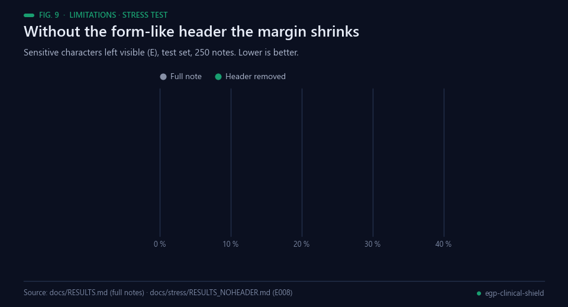<br><sub>Fig. 9 — Stress test E008. Data: docs/RESULTS.md and docs/stress/RESULTS_NOHEADER.md.</sub></p>

- Synthetic Spanish cases from one corpus with a uniform header template; real notes are messier, and the margin over Presidio shrinks on narrative text.

<p align="center">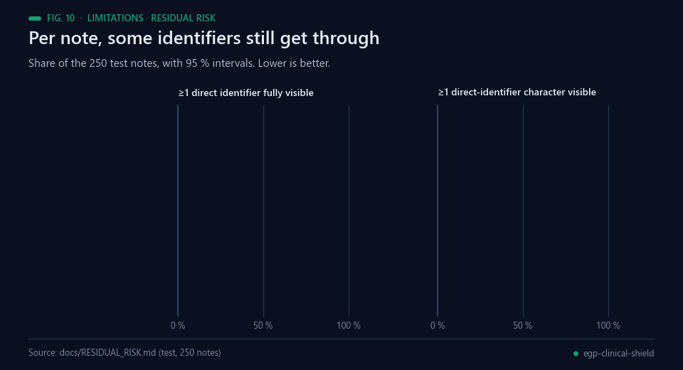<br><sub>Fig. 10 — Per-note residual risk on the test set. Data: docs/RESIDUAL_RISK.md.</sub></p>

- Rule-based detection: about one note in four keeps at least one fully visible direct identifier in the default mode. Not a replacement for validated de-identification pipelines.
- Placeholders protect identity, not every quasi-identifier: a rare disease plus a small town can still point to a person.
- How well real AI models keep and use placeholders is not measured yet.
- Not a medical device and not legal advice. A clinic that deploys it still needs its own data-protection impact assessment and legal basis.

## Real-world applications

<p align="center">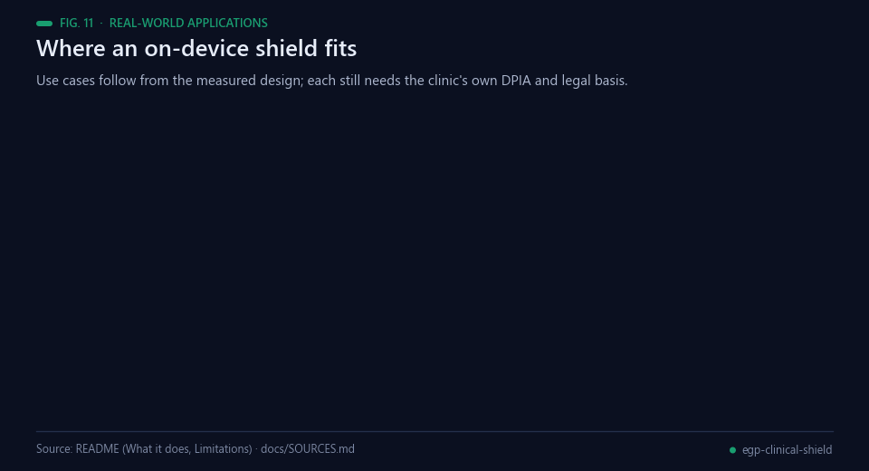<br><sub>Fig. 11 — Where an on-device shield fits. Each deployment still needs its own DPIA and legal basis.</sub></p>

Health systems are short of staff — WHO projects a shortage of 11.1 million health workers by 2030 [[14](#ref-14)] —
and clinicians already reach for AI assistants to save documentation time [[12](#ref-12)]. Applications that follow
from the measured design:

- **Clinical documentation with AI assistants.** Letters, discharge summaries and referral drafts written with a
  general-purpose assistant while names, record numbers, addresses and dates stay on the clinician's computer.
- **Reasoning support without identity.** Differential-diagnosis prompts keep age, sex, symptoms, lab values and
  drugs — what the model needs — and drop who the patient is.
- **A middle path for services that ban AI.** Instead of a blanket ban or shadow use, a service can inspect and
  assess a local, open-source layer whose residual risk is measured and published.
- **Low-resource settings.** The default mode needs no GPU and no ML model and ran in under 3 ms per note on a 2019
  desktop CPU, so it may suit ordinary clinic PCs (measured on one desktop; laptop timing is not yet measured).
- **Provider-agnostic deployments.** The same wrapper sits in front of OpenAI, Anthropic or a local model, and
  refuses content it cannot mask (images, tool calls, extra request arguments).
- **Privacy audits before rollout.** The residual-risk tooling shows, note by note, what an external model would
  still see — useful evidence for a data-protection impact assessment.

## Possible improvements

<p align="center">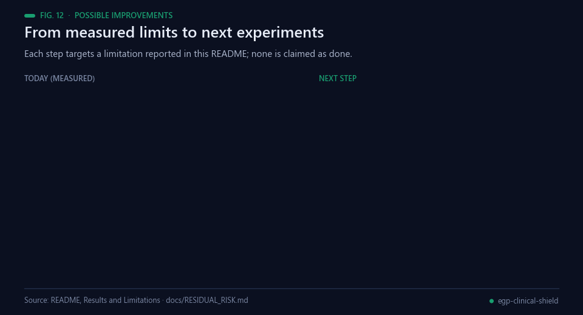<br><sub>Fig. 12 — Each improvement targets a limitation reported in this repository.</sub></p>

- **Broader evaluation data.** MEDDOCAN is synthetic, Spanish and uses a uniform header; without that header the
  margin over Presidio shrinks (Fig. 9). Consented real notes from several services, narrative-heavy documents and
  other languages come first.
- **Narrative-text recall.** In the default mode about one note in four (24.8 %) keeps at least one fully visible
  direct identifier. A learned free-text detector combined with the health pack should be tested under a new
  frozen protocol, never tuned on the published test split.
- **Quasi-identifier risk.** Placeholders hide identity, not rare combinations (a rare disease plus a small town).
  A *k*-anonymity-style warning before sending [[8](#ref-8)] would make this residual risk visible to the clinician.
- **Placeholder fidelity with real models.** Restoration is exact with an echo model; how real assistants keep,
  move or paraphrase placeholders has not been measured.
- **Speed on clinic hardware.** Laptop latency is not measured yet, and the maximum-protection mode (with
  Presidio) costs about 52 ms per note against 2.7 ms for the default mode.

## Future work

<p align="center">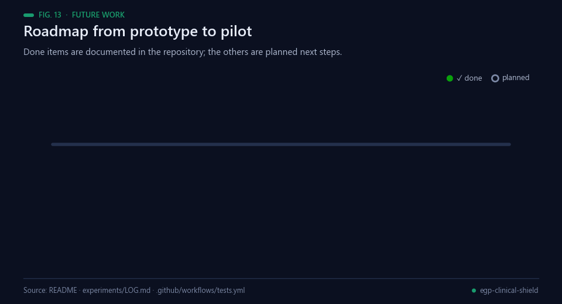<br><sub>Fig. 13 — Completed milestones are documented in this repository; the rest are planned.</sub></p>

Planned next steps, in order; none is claimed as started:

1. Measure latency of both modes on typical clinic laptops.
2. Run a placeholder-fidelity study with real AI assistants (exact restoration, lost or paraphrased placeholders).
3. Evaluate a narrative-text detector against the frozen cycle-c2 baseline under a new pre-registration.
4. Extend the health pack beyond Spanish and test it on independent corpora.
5. Pilot with a clinical partner, with a data-protection impact assessment and a documented legal basis.

## Licences

Code: MIT ([LICENSE](LICENSE)). MEDDOCAN data: CC BY 4.0, downloaded at run time, not redistributed (the residual-risk audit quotes 30 short synthetic fragments with attribution). Official MEDDOCAN scorer: MIT. Presidio: MIT. spaCy `es_core_news_lg`: GPL-3.0, downloaded at run time, not redistributed.

## Citation

```bibtex
@software{angulo2026egpclinical,
  title  = {EGP Clinical Shield: reversible pseudonymisation of clinical notes before AI assistants},
  author = {Angulo de Lafuente, Francisco},
  year   = {2026},
  url    = {https://github.com/Agnuxo1/egp-clinical-shield}
}
```

## Bibliography

1. <a id="ref-1"></a>Marimon, M., Gonzalez-Agirre, A., Intxaurrondo, A., Rodríguez, H., Lopez Martin, J. A., Villegas, M., & Krallinger, M. (2019). Automatic de-identification of medical texts in Spanish: the MEDDOCAN track, corpus, guidelines, methods and evaluation of results. *Proceedings of the Iberian Languages Evaluation Forum (IberLEF 2019)*, CEUR Workshop Proceedings 2421, 618–638. https://ceur-ws.org/Vol-2421/MEDDOCAN_overview.pdf
2. <a id="ref-2"></a>Marimon, M., Gonzalez-Agirre, A., Intxaurrondo, A., et al. (2020). *MEDDOCAN corpus: gold standard annotations for Medical Document Anonymization on Spanish clinical case reports*. Zenodo. https://doi.org/10.5281/zenodo.4279323
3. <a id="ref-3"></a>Lange, L., Adel, H., & Strötgen, J. (2020). NLNDE: The Neither-Language-Nor-Domain-Experts' Way of Spanish Medical Document De-Identification. *arXiv* 2007.01030. https://arxiv.org/abs/2007.01030
4. <a id="ref-4"></a>Uzuner, O., Luo, Y., & Szolovits, P. (2007). Evaluating the State-of-the-Art in Automatic De-identification. *Journal of the American Medical Informatics Association*, 14(5), 550–563. https://doi.org/10.1197/jamia.M2444
5. <a id="ref-5"></a>Stubbs, A., & Uzuner, Ö. (2015). Annotating longitudinal clinical narratives for de-identification: The 2014 i2b2/UTHealth corpus. *Journal of Biomedical Informatics*, 58, S20–S29. https://doi.org/10.1016/j.jbi.2015.07.020
6. <a id="ref-6"></a>Meystre, S. M., Friedlin, F. J., South, B. R., Shen, S., & Samore, M. H. (2010). Automatic de-identification of textual documents in the electronic health record: a review of recent research. *BMC Medical Research Methodology*, 10, 70. https://doi.org/10.1186/1471-2288-10-70
7. <a id="ref-7"></a>Dernoncourt, F., Lee, J. Y., Uzuner, Ö., & Szolovits, P. (2017). De-identification of patient notes with recurrent neural networks. *Journal of the American Medical Informatics Association*, 24(3), 596–606. https://doi.org/10.1093/jamia/ocw156
8. <a id="ref-8"></a>Sweeney, L. (2002). k-anonymity: A model for protecting privacy. *International Journal of Uncertainty, Fuzziness and Knowledge-Based Systems*, 10(5), 557–570. https://doi.org/10.1142/S0218488502001648
9. <a id="ref-9"></a>Lison, P., Pilán, I., Sanchez, D., Batet, M., & Øvrelid, L. (2021). Anonymisation Models for Text Data: State of the art, Challenges and Future Directions. *Proceedings of the 59th Annual Meeting of the Association for Computational Linguistics and the 11th International Joint Conference on Natural Language Processing (Volume 1: Long Papers)*, 4188–4203. https://doi.org/10.18653/v1/2021.acl-long.323
10. <a id="ref-10"></a>U.S. Department of Health and Human Services, Office for Civil Rights (2012). *Guidance regarding methods for de-identification of protected health information in accordance with the HIPAA Privacy Rule* (page last reviewed 3 February 2025). https://www.hhs.gov/hipaa/for-professionals/special-topics/de-identification/index.html
11. <a id="ref-11"></a>European Parliament and Council of the European Union (2016). Regulation (EU) 2016/679 (General Data Protection Regulation). *Official Journal of the European Union*, L 119, 1–88. https://eur-lex.europa.eu/eli/reg/2016/679/oj
12. <a id="ref-12"></a>Blease, C. R., Locher, C., Gaab, J., Hägglund, M., & Mandl, K. D. (2024). Generative artificial intelligence in primary care: an online survey of UK general practitioners. *BMJ Health & Care Informatics*, 31(1), e101102. https://doi.org/10.1136/bmjhci-2024-101102
13. <a id="ref-13"></a>World Health Organization (2024). *Ethics and governance of artificial intelligence for health: Guidance on large multi-modal models*. https://www.who.int/publications/i/item/9789240084759
14. <a id="ref-14"></a>World Health Organization, Executive Board (2024). *Health and care workforce* (EB156/15). https://apps.who.int/gb/ebwha/pdf_files/EB156/B156_15-en.pdf
15. <a id="ref-15"></a>Honnibal, M., Montani, I., Van Landeghem, S., & Boyd, A. (2020). *spaCy: Industrial-strength natural language processing in Python*. Zenodo. https://doi.org/10.5281/zenodo.1212303
16. <a id="ref-16"></a>Microsoft. *Presidio: data protection and de-identification SDK* (software). https://github.com/microsoft/presidio
17. <a id="ref-17"></a>Plan TL Sanidad. *MEDDOCAN evaluation script* (software; commit 843152c used here). https://github.com/PlanTL-GOB-ES/MEDDOCAN-Evaluation-Script
18. <a id="ref-18"></a>Efron, B., & Tibshirani, R. J. (1994). *An Introduction to the Bootstrap*. Chapman and Hall/CRC. https://doi.org/10.1201/9780429246593
19. <a id="ref-19"></a>Nosek, B. A., Ebersole, C. R., DeHaven, A. C., & Mellor, D. T. (2018). The preregistration revolution. *Proceedings of the National Academy of Sciences*, 115(11), 2600–2606. https://doi.org/10.1073/pnas.1708274114

---

<div align="center">
<sub>Built by <a href="https://github.com/Agnuxo1">Francisco Angulo de Lafuente</a> · every figure is an animated
rendering of the published file named in its footer · <a href="#egp-clinical-shield">back to top ↑</a></sub>
</div>
