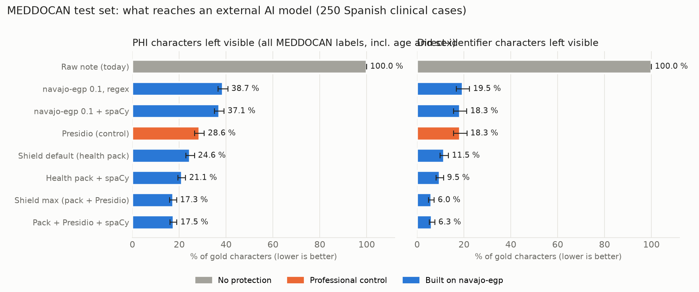

# Results — NAVAJO de-identification PoC on MEDDOCAN

Environment: `{"python": "3.13.7", "platform": "Windows-10-10.0.19045-SP0", "numpy": "2.4.6", "spacy": "3.8.16", "presidio_analyzer": "?", "es_core_news_lg": "3.8.0", "build_seconds": 4.0, "presidio_recognizers_es": ["CreditCardRecognizer", "CryptoRecognizer", "DateRecognizer", "EmailRecognizer", "EsNieRecognizer", "EsNifRecognizer", "IbanRecognizer", "IpRecognizer", "MacAddressRecognizer", "MedicalLicenseRecognizer", "PhoneRecognizer", "SpacyRecognizer", "UrlRecognizer"], "presidio_added_for_es": []}`

### test (250 documents)

| System | Primary: span leak L (strict) | PHI characters left visible E [95% CI] | Direct-identifier characters left visible | Non-PHI text masked O | Span precision / F1 | ms/note | Exact restore (echo model) |
|---|---|---|---|---|---|---|---|
| Raw note (today) | 100.0 % | 100.0 % [100.0–100.0] | 100.0 % | 0.0 % | 0.000 / 0.000 | 0.0 | — |
| navajo-egp 0.1, regex | 76.5 % | 38.7 % [36.6–40.7] | 19.5 % | 1.3 % | 0.451 / 0.309 | 1.34 | 0.0 % |
| navajo-egp 0.1 + spaCy | 76.9 % | 37.1 % [35.0–39.1] | 18.3 % | 1.8 % | 0.366 / 0.283 | 37.9 | 2.4 % |
| Presidio (control) | 64.7 % | 28.6 % [26.6–30.7] | 18.3 % | 3.1 % | 0.278 / 0.311 | 53.71 | — |
| Shield default (health pack) | 53.7 % | 24.6 % [22.8–26.5] | 11.5 % | 0.9 % | 0.628 / 0.533 | 2.47 | 100.0 % |
| Health pack + spaCy | 49.7 % | 21.1 % [19.4–22.7] | 9.5 % | 2.8 % | 0.356 / 0.417 | 60.81 | 100.0 % |
| Shield max (pack + Presidio) | 57.5 % | 17.3 % [15.9–18.9] | 6.0 % | 3.5 % | 0.305 / 0.355 | 50.47 | 100.0 % |
| Pack + Presidio + spaCy | 57.4 % | 17.5 % [16.0–19.0] | 6.3 % | 3.6 % | 0.304 / 0.355 | 109.88 | 100.0 % |

## Pre-registered tests and ablations (paired document bootstrap)

| Comparison | Split | Metric | Difference (points) | 95% CI, seeds 0/1/2 | Reading |
|---|---|---|---|---|---|
| H1  NAVAJO 0.1 vs Presidio: navajo-egp 0.1 + spaCy − Presidio (control) | test | E_exposure | +8.50 | [+6.40, +10.54] / [+6.47, +10.64] / [+6.41, +10.68] | A higher (CI above 0) |
| H3a hybrid vs NAVAJO health: Pack + Presidio + spaCy − Health pack + spaCy | test | E_exposure | -3.57 | [-4.48, -2.73] / [-4.48, -2.74] / [-4.51, -2.74] | A lower (CI below 0) |
| H3b hybrid vs Presidio: Pack + Presidio + spaCy − Presidio (control) | test | E_exposure | -11.09 | [-12.95, -9.31] / [-12.89, -9.39] / [-12.84, -9.42] | A lower (CI below 0) |
| Abl. NAVAJO health vs Presidio: Health pack + spaCy − Presidio (control) | test | E_exposure | -7.52 | [-9.69, -5.39] / [-9.58, -5.50] / [-9.49, -5.51] | A lower (CI below 0) |
| Abl. NAVAJO health vs Presidio (direct ids): Health pack + spaCy − Presidio (control) | test | DI_E_exposure | -8.76 | [-11.87, -5.77] / [-11.71, -5.99] / [-11.61, -6.00] | A lower (CI below 0) |
| Abl. hybrid vs Presidio (direct ids): Pack + Presidio + spaCy − Presidio (control) | test | DI_E_exposure | -12.01 | [-14.76, -9.56] / [-14.60, -9.63] / [-14.58, -9.64] | A lower (CI below 0) |
| Abl. hybrid over-masking vs Presidio: Pack + Presidio + spaCy − Presidio (control) | test | O_overmask | +0.41 | [+0.28, +0.58] / [+0.28, +0.58] / [+0.28, +0.58] | A higher (CI above 0) |
| Abl. spaCy inside hybrid: Pack + Presidio + spaCy − Shield max (pack + Presidio) | test | E_exposure | +0.15 | [+0.04, +0.27] / [+0.04, +0.27] / [+0.04, +0.27] | A higher (CI above 0) |
| Abl. NAVAJO inside hybrid, no spaCy: Shield max (pack + Presidio) − Presidio (control) | test | E_exposure | -11.24 | [-13.10, -9.45] / [-13.06, -9.51] / [-12.96, -9.58] | A lower (CI below 0) |
| Abl. Presidio inside hybrid, no spaCy: Shield max (pack + Presidio) − Shield default (health pack) | test | E_exposure | -7.26 | [-8.66, -5.98] / [-8.66, -5.89] / [-8.65, -5.92] | A lower (CI below 0) |
| Abl. Presidio inside hybrid, no spaCy (over-masking): Shield max (pack + Presidio) − Shield default (health pack) | test | O_overmask | +2.65 | [+2.44, +2.87] / [+2.45, +2.87] / [+2.45, +2.86] | A higher (CI above 0) |
| Abl. NAVAJO health no spaCy vs Presidio: Shield default (health pack) − Presidio (control) | test | E_exposure | -3.98 | [-6.50, -1.42] / [-6.40, -1.60] / [-6.34, -1.56] | A lower (CI below 0) |
| Abl. NAVAJO health no spaCy vs Presidio (over-masking): Shield default (health pack) − Presidio (control) | test | O_overmask | -2.24 | [-2.50, -1.98] / [-2.49, -1.98] / [-2.49, -1.99] | A lower (CI below 0) |

## Per-label character coverage (test)

| Gold label | n | navajo-egp 0.1, regex | navajo-egp 0.1 + spaCy | Presidio (control) | Health pack + spaCy | Pack + Presidio + spaCy |
|---|---|---|---|---|---|---|
| TERRITORIO | 437 | 49 % | 49 % | 72 % | 91 % | 97 % |
| EDAD_SUJETO_ASISTENCIA | 269 | 0 % | 0 % | 1 % | 0 % | 1 % |
| NOMBRE_PERSONAL_SANITARIO * | 251 | 96 % | 99 % | 98 % | 97 % | 100 % |
| CORREO_ELECTRONICO * | 248 | 98 % | 98 % | 100 % | 97 % | 100 % |
| SEXO_SUJETO_ASISTENCIA | 218 | 0 % | 0 % | 1 % | 0 % | 1 % |
| CALLE * | 167 | 66 % | 67 % | 68 % | 77 % | 83 % |
| HOSPITAL | 130 | 66 % | 71 % | 89 % | 95 % | 98 % |
| PAIS | 116 | 26 % | 25 % | 96 % | 100 % | 100 % |
| FECHAS * | 113 | 4 % | 4 % | 8 % | 84 % | 84 % |
| FAMILIARES_SUJETO_ASISTENCIA | 80 | 0 % | 2 % | 4 % | 4 % | 4 % |
| INSTITUCION | 67 | 44 % | 48 % | 84 % | 80 % | 93 % |
| NUMERO_TELEFONO * | 24 | 66 % | 66 % | 5 % | 97 % | 97 % |
| ID_SUJETO_ASISTENCIA * | 13 | 0 % | 0 % | 0 % | 0 % | 0 % |
| PROFESION | 9 | 0 % | 0 % | 0 % | 0 % | 0 % |
| OTROS_SUJETO_ASISTENCIA | 7 | 0 % | 0 % | 0 % | 0 % | 0 % |
| NUMERO_FAX * | 7 | 54 % | 54 % | 17 % | 100 % | 100 % |
| CENTRO_SALUD | 6 | 39 % | 39 % | 98 % | 100 % | 100 % |
| NOMBRE_SUJETO_ASISTENCIA * | 2 | 0 % | 100 % | 100 % | 100 % | 100 % |

Cells: share of the label's characters masked. * = direct identifier.

Post-hoc analyses (no system changed): [POSTHOC.md](POSTHOC.md).
